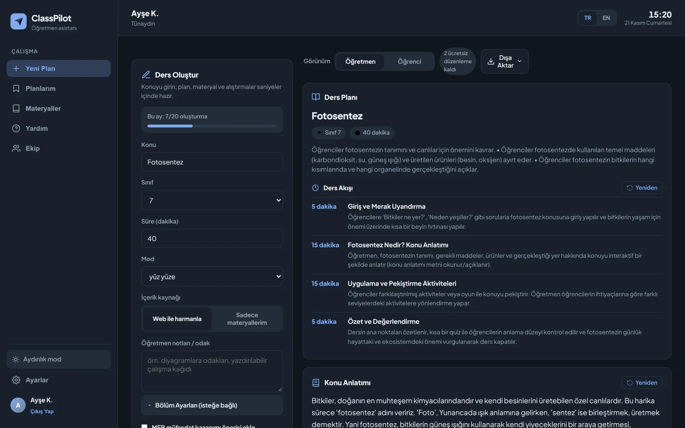
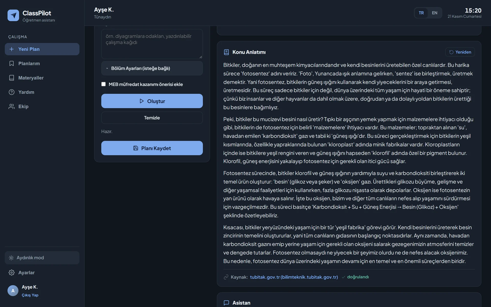
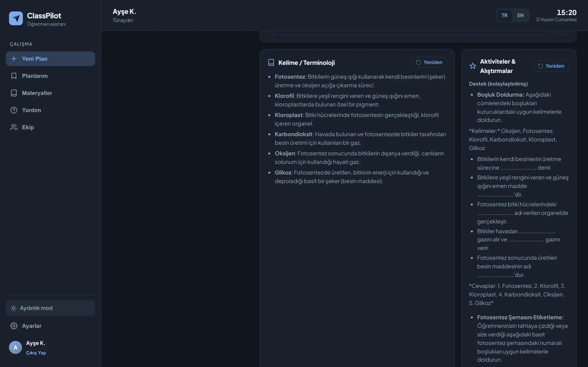
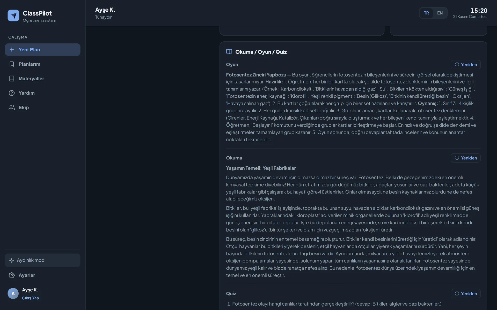
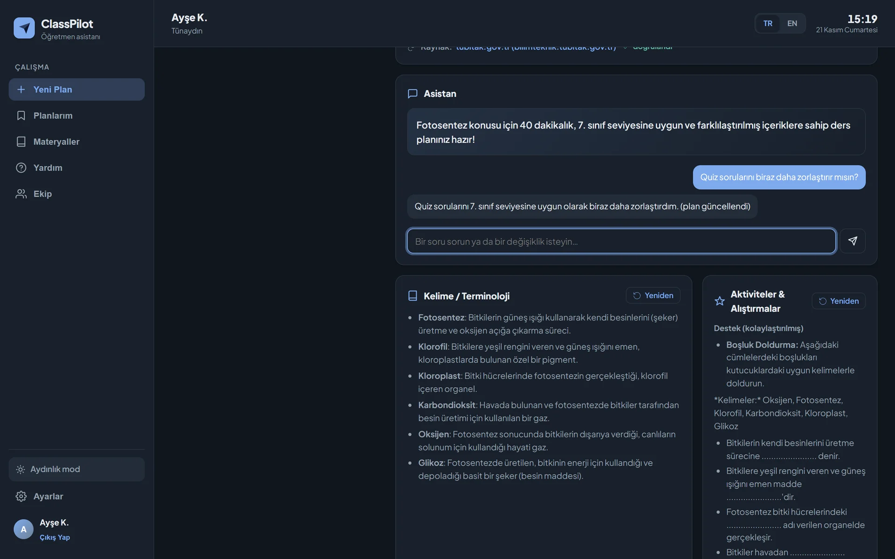
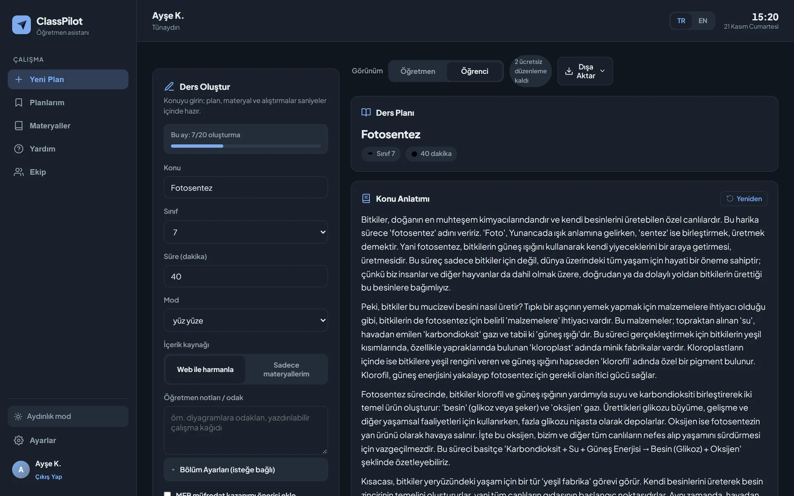
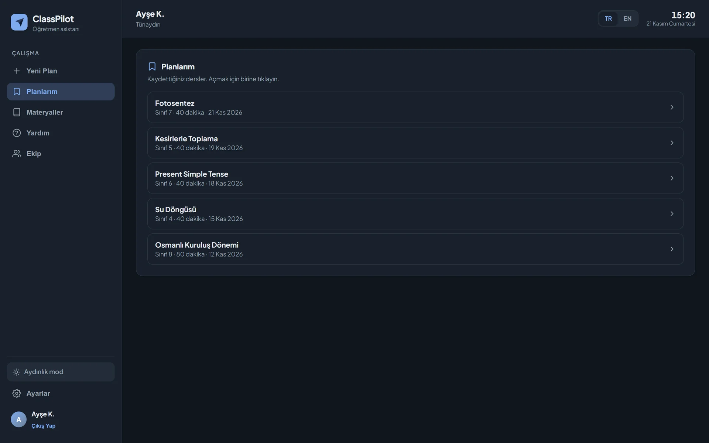
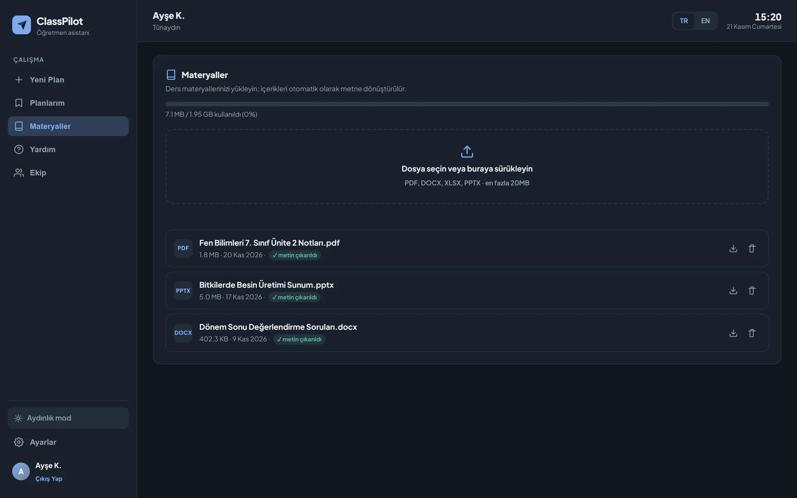
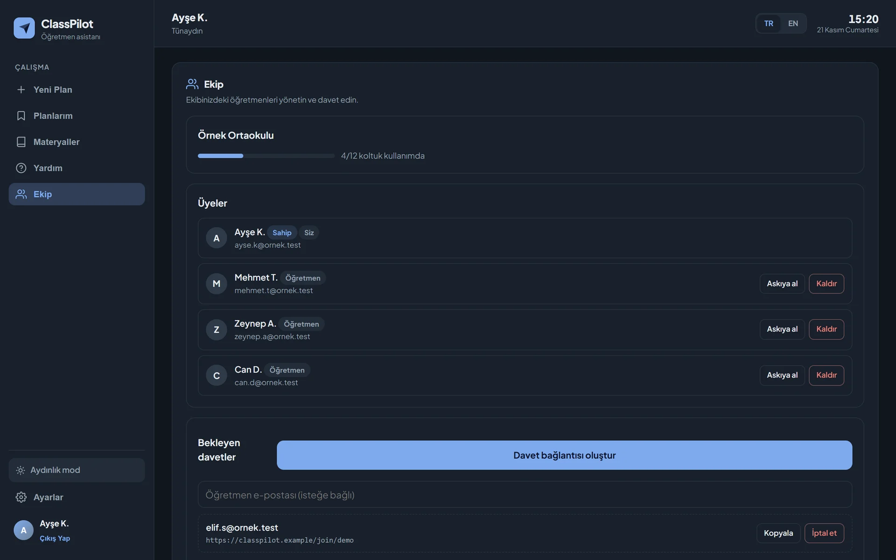

# ClassPilot · Product Demo

Lesson planning assistant for teachers in Turkey. A teacher enters a topic, a grade and the lesson length, and ClassPilot builds a complete lesson: objectives, a timed lesson flow, a topic narrative, key terms, activities at three levels, worksheets, a classroom game, a reading passage and a quiz. Teachers can ground a lesson in their own uploaded documents, edit any section by asking the assistant, and export the result.

> **Showcase only.** This repository contains screenshots and a description, **no source code**. The product is proprietary and closed-source. Every screen below shows an **invented teacher and school** ("Ayşe K.", "Örnek Ortaokulu"); no real person, school or student data appears anywhere. The lesson content was generated by the product itself for the sample topic "Fotosentez" (grade 7, 40 minutes). The interface is in Turkish and English; these screenshots show the Turkish version.

## The screens

### Lesson plan
Topic, grade and duration in; objectives and a timed lesson flow out. The monthly usage meter and the remaining free section edits are shown alongside, and every section can be regenerated on its own.

### Topic narrative
A full explanation written for the chosen grade, with the trusted source it was checked against.

### Key terms and activities
Terms with grade-level definitions, and activities split into supported, core and advanced levels so one plan serves a mixed class.

### Game, reading and quiz
A ready-to-run classroom game, a short reading passage and a quiz with answers.

### Assistant
The teacher asks for a change in plain language ("make the quiz a little harder") and the assistant rewrites only that section of the plan.

### Student view
The same lesson as a hand-out: objectives, lesson flow and quiz answers are removed.

### My plans
Saved lessons per teacher, ready to reopen, share or export.

### Materials
Teachers upload their own PDF, Word, Excel and PowerPoint files. The text is extracted so a lesson can be built only from the teacher's materials.

### School workspace
A school owner invites teachers with single-use links, manages seats, and can suspend or remove members.

## How it is built

- **Generation:** structured lesson output with per-section regeneration and a conversational editor; content is grounded either in a trusted web source or only in the teacher's own documents.
- **Exports:** PDF, Word, Excel and PowerPoint, in a teacher version and a student version.
- **Accounts:** individual and school workspaces, seat limits, monthly generation caps, storage limits and trial expiry, all enforced on the server.
- **Data isolation:** every table is protected by row-level security in PostgreSQL, so one school can never read another's plans or files.
- **Owner admin panel:** account overview, reversible freeze and deletion, with every action written to an audit log.
- **Stack:** Node.js and Express, Supabase (PostgreSQL, Auth, Storage), a plain HTML, CSS and JavaScript front end, and Google Gemini for generation with optional fallback providers.

Development happens in a private repository, with versioned releases and release notes.

## Status

Piloting at a school. Individual subscriptions open after the pilot.

## Contact

Built by **[Softburn.tech](https://softburn.tech)**.
